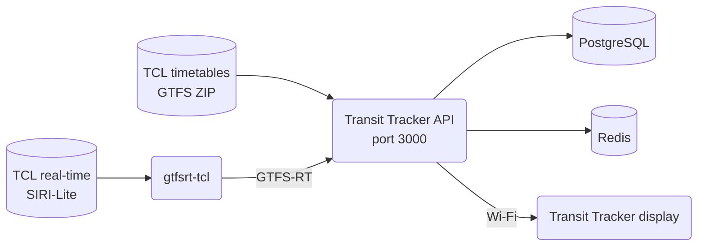

# Running Transit Tracker for Lyon (TCL) on your own computer

This guide sets up everything a Transit Tracker display needs to show TCL departures in Lyon, using Docker on your own computer:



- **Transit Tracker API** (this repository) imports the TCL timetables and streams departures to the display.
- **[gtfsrt-tcl](https://github.com/kevinbioj/gtfsrt-tcl)** turns TCL's real-time data, which is only published as SIRI-Lite, into GTFS-Realtime, which the API understands.
- **PostgreSQL** and **Redis** are used internally by the API.

Both TCL data sources are hosted on [data.grandlyon.com](https://data.grandlyon.com) and require a free account.

The Docker files for this setup are in [`deploy/lyon/`](../../deploy/lyon/).

## 1. Prerequisites

- **Docker** with Compose v2 (`docker compose`, not `docker-compose`):
  - Windows or macOS: install [Docker Desktop](https://www.docker.com/products/docker-desktop/) and start it.
  - Linux: install [Docker Engine](https://docs.docker.com/engine/install/) and the Compose plugin.
- **Git**.
- About **5 GB** of free disk space for the images and the timetable database.
- The computer must stay on and be on the **same network** as the display. The display only supports **2.4 GHz** Wi-Fi.
- **Google Chrome** or **Microsoft Edge** for the configurator (it uses Web Serial, which other browsers do not support).

Check that Docker works:

```shell
docker compose version
```

This should print `Docker Compose version v2...` or newer.

> [!NOTE]
> Commands in this guide are written for a macOS/Linux terminal. On Windows, use **PowerShell**; where a command differs, the PowerShell version is given right after it.

## 2. Get access to the TCL data

1. Create an account on [data.grandlyon.com](https://data.grandlyon.com) and confirm your email address.
2. Your login is your **email address** and your **password**. Both data sources below use them.
3. Check that your account can download each of the three resources. Replace `you@example.com:your-password` with your own email and password, keeping the single quotes.

   macOS/Linux:

   ```shell
   curl -s -o /dev/null -w "%{http_code}\n" -u 'you@example.com:your-password' https://download.data.grandlyon.com/files/rdata/tcl_sytral.tcltheorique/GTFS_TCL.ZIP
   curl -s -o /dev/null -w "%{http_code}\n" -u 'you@example.com:your-password' https://data.grandlyon.com/siri-lite/2.0/estimated-timetables.json
   curl -s -o /dev/null -w "%{http_code}\n" -u 'you@example.com:your-password' https://data.grandlyon.com/siri-lite/2.0/vehicle-monitoring.json
   ```

   Windows PowerShell (type `curl.exe`, not `curl`):

   ```powershell
   curl.exe -s -o NUL -w "%{http_code}\n" -u 'you@example.com:your-password' https://download.data.grandlyon.com/files/rdata/tcl_sytral.tcltheorique/GTFS_TCL.ZIP
   curl.exe -s -o NUL -w "%{http_code}\n" -u 'you@example.com:your-password' https://data.grandlyon.com/siri-lite/2.0/estimated-timetables.json
   curl.exe -s -o NUL -w "%{http_code}\n" -u 'you@example.com:your-password' https://data.grandlyon.com/siri-lite/2.0/vehicle-monitoring.json
   ```

   **All three must print `200`.** If one prints `401` or `403`, your account does not have access to that resource yet: open the matching dataset on data.grandlyon.com while logged in ("Horaires théoriques du réseau Transports en Commun Lyonnais" for the ZIP, and the TCL SIRI-Lite real-time datasets for the other two), and request access if the page offers it. Don't continue until all three print `200`.

> [!IMPORTANT]
> gtfsrt-tcl needs **both** SIRI-Lite resources. If `vehicle-monitoring.json` fails, it never publishes any real-time data, even though `estimated-timetables.json` works.

## 3. Download both repositories

Put both repositories **in the same folder**, side by side. The Docker setup relies on this layout.

```shell
mkdir transit
cd transit
git clone https://github.com/tiralmos/transit-tracker-lyon.git
git clone https://github.com/kevinbioj/gtfsrt-tcl.git
```

You should now have:

```
transit/
├── transit-tracker-lyon/
└── gtfsrt-tcl/
```

If the Lyon setup has not been merged yet, switch to the branch that contains it:

```shell
git -C transit-tracker-lyon checkout claude/lyon-feed-docker-kc8k16
```

This guide was tested with gtfsrt-tcl commit `f428659`. To use exactly that version:

```shell
git -C gtfsrt-tcl checkout f428659
```

## 4. Enter your credentials

Go to the Lyon deployment folder and create your `.env` file from the example:

```shell
cd transit-tracker-lyon/deploy/lyon
cp .env.example .env
```

PowerShell:

```powershell
cd transit-tracker-lyon\deploy\lyon
Copy-Item .env.example .env
```

The file needs your login twice: once as plain text for gtfsrt-tcl, and once base64-encoded for the API. Generate the base64 version (again keeping the single quotes):

- Linux: `printf '%s' 'you@example.com:your-password' | base64 -w0; echo`
- macOS: `printf '%s' 'you@example.com:your-password' | base64`
- PowerShell: `[Convert]::ToBase64String([Text.Encoding]::UTF8.GetBytes('you@example.com:your-password'))`

The output is one line, for example `eW91QGV4YW1wbGUuY29tOnlvdXItcGFzc3dvcmQ=`.

Open `.env` in a text editor and replace both example values:

```shell
GRANDLYON_CREDENTIALS='you@example.com:your-password'
GRANDLYON_BASIC_AUTH='eW91QGV4YW1wbGUuY29tOnlvdXItcGFzc3dvcmQ='
```

- Keep the single quotes around each value. They let your password contain characters such as `$`, `!`, `"` or `#`.
- If your password contains a single quote (`'`), change it on data.grandlyon.com to one without, since it cannot be written inside single quotes.

Check that Docker reads the file correctly:

```shell
docker compose config --quiet
```

It should print nothing. If it prints `Set GRANDLYON_... in deploy/lyon/.env`, that variable is missing or empty.

> [!WARNING]
> `.env` contains your password. It is ignored by Git, so it won't be committed, but don't share it.

**All remaining `docker compose` commands must be run from this `deploy/lyon` folder.**

## 5. Build the images

```shell
docker compose build
```

This builds the Transit Tracker API from this repository and gtfsrt-tcl from the folder next to it. It takes a few minutes the first time. It should end with two lines like:

```
 Image transit-tracker-lyon-api Built
 Image transit-tracker-lyon-gtfsrt-tcl Built
```

If the gtfsrt-tcl build fails with `additional privileges requested`, `failed to read dockerfile` or `path not found`, the two repositories are not side by side, or the `gtfsrt-tcl` folder has a different name (see step 3).

## 6. Create the database and import the timetables

```shell
docker compose run --rm api "pnpm gtfs:db:migrate && node ./dist/cli sync"
```

This starts PostgreSQL, Redis and gtfsrt-tcl, creates the database tables, then downloads and imports the TCL timetables. The TCL network is large (hundreds of routes, over 100,000 trips), so the import can take several minutes.

It succeeded if the output contains `Import done` followed by `Sync of all feeds completed`.

> [!IMPORTANT]
> A line saying `Feed Sync Completed` appears **even when the import failed**. Look for `Sync of feed "tcl" failed` instead:
>
> - `failed: ... 401` or `403`: the `GRANDLYON_BASIC_AUTH` value is wrong. Redo the base64 step, then run this step again.
> - `failed: fetch failed`: your computer could not reach download.data.grandlyon.com. Check your internet connection.

The timetables are re-imported automatically every night at 04:00 when TCL publishes a new file. To re-import by hand at any time:

```shell
docker compose run --rm api "node ./dist/cli sync"
```

## 7. Start everything

```shell
docker compose up -d
```

Check that all four services are running:

```shell
docker compose ps
```

`api`, `gtfsrt-tcl`, `postgres` and `redis` should all be `Up`, and postgres `(healthy)`.

Then check that gtfsrt-tcl is receiving real-time data (wait about 30 seconds after starting):

```shell
docker compose logs --tail 20 gtfsrt-tcl
```

You should see blocks ending with `✓ Done updating in ...ms`, with `Processed N trip updates` where N is above 0 while TCL is running. If you see `✘ Unable to update entities` with `http status 401`, the `GRANDLYON_CREDENTIALS` value is wrong: fix `.env`, then run `docker compose up -d` again.

The services restart on their own when the computer or Docker restarts. To stop them, run `docker compose down` (your imported data is kept).

## 8. Check the API serves Lyon departures

Open these addresses in a browser on the same computer.

1. **The feed is loaded:** <http://localhost:3000/feeds>

   You should see `"code":"tcl"`, a `lastSyncedAt` date, and `"supportsGtfsRealtime":true`.

2. **Find a stop.** This lists the stops around Bellecour (the box must stay under 5 km²):

   <http://localhost:3000/stops/within/4.828,45.754,4.840,45.762>

   Pick a stop from the list and note its `stopId`, for example `tcl:12345`.

3. **List the routes at that stop**, replacing `tcl:12345`:

   `http://localhost:3000/stops/tcl:12345/routes`

   Note a `routeId`, for example `tcl:C3`.

4. **Get the next departures** for that route and stop:

   `http://localhost:3000/schedule/tcl:C3,tcl:12345`

   You should see upcoming `trips`. `"isRealtime":true` means the time comes from TCL's real-time data; `false` means it is the timetable time.

5. **Check that real-time data lines up with the timetable:**

   ```shell
   docker compose exec api node scripts/check-rt-trip-match.mjs tcl http://gtfsrt-tcl:3000/trip-updates
   ```

   It prints something like `1234 of 1250 real-time trips match the static timetable.` A few unmatched trips are normal. If **none** match, departures will still show, but only with timetable times, never real-time ones.

You can also look at the raw real-time feed at <http://localhost:50008/trip-updates.json>. This address only works on the computer running Docker.

## 9. Make the API reachable from the display

The display connects to your computer over Wi-Fi, so it needs your computer's local IP address.

1. Find it:
   - Windows: run `ipconfig` and read `IPv4 Address` under your Wi-Fi or Ethernet adapter.
   - macOS: System Settings → Wi-Fi → Details → IP address, or run `ipconfig getifaddr en0`.
   - Linux: run `hostname -I` and take the first address.

   It usually looks like `192.168.1.42`. The rest of this guide uses `192.168.1.42`; use your own.

2. Give your computer a **fixed address** in your router's settings (often called a DHCP reservation or static lease). Otherwise the address can change and the display will stop updating.

3. Allow incoming connections on port **3000**:
   - Windows: the first time Docker Desktop opens a port, Windows Firewall may ask for permission. Allow it on **private** networks.
   - macOS: if the firewall is on, allow Docker when asked.
   - Linux: if you use `ufw`, run `sudo ufw allow 3000/tcp`.

4. From your **phone**, connected to the same Wi-Fi, open `http://192.168.1.42:3000/feeds`. You should see the same `tcl` feed as in step 8. If it doesn't load, the display won't be able to connect either: check the IP address and firewall.

## 10. Point the display at your API

If the display has never been set up, first follow the official [Flash & Configure guide](https://transit-tracker.eastsideurbanism.org/docs/build-guide/flash-and-configure) to flash the firmware and connect it to Wi-Fi, then come back here.

1. Open the [configurator](https://transit-tracker.eastsideurbanism.org/configurator) in Chrome or Edge.
2. Go to the **Advanced** tab. Under **API Server**, change the server to `http://192.168.1.42:3000` (with `http://`, your own IP address, and `:3000`). If the browser asks to **find and connect to devices on your local network**, choose **Allow**.
3. Changing the server clears your routes. Go back to the routes tab and add your TCL stops and routes. They come from your own API now.
4. Connect the display by USB and press **Save configuration to device**.

The display saves the address as `ws://192.168.1.42:3000/` and should show TCL departures within a few seconds.

> [!NOTE]
> If the configurator says `Unable to connect to the API server` even though step 9.4 works from your phone, your browser is blocking a secure page from talking to a plain `http://` address on your network. In Chrome or Edge, click the icon left of the address bar → **Site settings** → set **Insecure content** to **Allow**, reload the page and try again.

## Troubleshooting

| Symptom | Cause and fix |
| --- | --- |
| `docker compose` says `no configuration file provided` | You are not in `transit-tracker-lyon/deploy/lyon`. `cd` there first. |
| Departures show but `isRealtime` is always `false` | Check `docker compose logs gtfsrt-tcl` (step 7) and run the matching check (step 8.5). Real-time data only exists while TCL vehicles are running. |
| Some lines or the metro show no departures | Run `docker compose exec postgres psql -U postgres -d gtfs -c "select count(*) from frequencies"`. If it's above 0, TCL describes some services by frequency ("every 4 minutes"), which the API does not support yet, so those trips are skipped. |
| The display shows "Error loading schedule" | The display can't reach your computer. Redo step 9.4 from your phone and check the computer is on and Docker is running. |
| Departures stop updating after a few weeks | The timetables are re-imported nightly. Check `docker compose logs api` for `Sync of feed "tcl" failed`, which usually means your data.grandlyon.com password changed: update `.env`, then `docker compose up -d`. |

To update to a newer version later:

```shell
git -C ../.. pull
git -C ../../../gtfsrt-tcl pull
docker compose build
docker compose up -d
```
