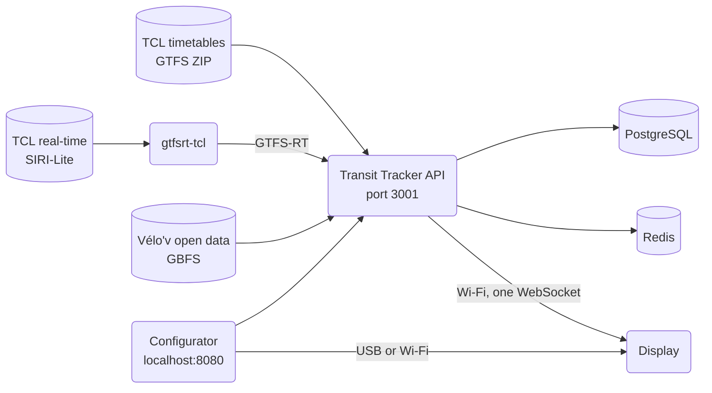

# Running Transit Tracker Lyon (TCL + Vélo'v)

This guide sets up one Transit Tracker display (Adafruit Matrix Portal S3 with two 64x32 LED panels) that shows **both** Lyon's TCL departures and Vélo'v bike stations. Everything runs in Docker on your own computer.

You choose what each row shows:

```
C3  Gare St-Paul        ((•)) 4min    ← a TCL line at a stop: next departure
C3  Gare St-Paul             14min    ← the same line again: the departure after
[V] Bancel  [P] 5  [bike] 0  [⚡bike] 11    ← a Vélo'v station: free docks, bikes, e-bikes
```

The display has room for 3 rows, or 2 if you add header text. With **time slots** you can show other rows at other times of the day, e.g. your tram in the morning and your Vélo'v station in the evening.



The project is made of four repositories:

| Repository | What it is |
| --- | --- |
| [transit-tracker-lyon-api](https://github.com/tiralmos/transit-tracker-lyon-api) | The API (this repository). Docker files in [`deploy/tcl-velov/`](../../deploy/tcl-velov/). |
| [transit-tracker-lyon-configurator](https://github.com/tiralmos/transit-tracker-lyon-configurator) | The web page that flashes the display, sets its Wi-Fi and chooses its rows. |
| [transit-tracker-lyon-firmware](https://github.com/tiralmos/transit-tracker-lyon-firmware) | The display's firmware, published as GitHub releases. |
| [esphome-transit-tracker-lyon](https://github.com/tiralmos/esphome-transit-tracker-lyon) | The display code the firmware is built from. |

You also need [gtfsrt-tcl](https://github.com/kevinbioj/gtfsrt-tcl), which turns TCL's real-time data into a format the API reads.

> [!NOTE]
> Commands are written for a macOS/Linux terminal. On Windows, use **PowerShell**; where a command differs, the PowerShell version is given right after it.

## 1. Prerequisites

- **Docker** with Compose v2 (`docker compose`). On Windows or macOS, [Docker Desktop](https://www.docker.com/products/docker-desktop/), started.
- **Git**.
- About **5 GB** of free disk space.
- **Google Chrome** or **Microsoft Edge** (the configurator uses Web Serial for USB).
- A free **[data.grandlyon.com](https://data.grandlyon.com)** account (for TCL; Vélo'v needs none). If you followed the TCL guide ([deploy-lyon.md](deploy-lyon.md)), you already have it.
- The computer stays on, on the **same network** as the display (2.4 GHz Wi-Fi).
- A **firmware release** in [transit-tracker-lyon-firmware](https://github.com/tiralmos/transit-tracker-lyon-firmware/releases). See [Publishing the firmware](#publishing-the-firmware).

## 2. Download the repositories

Put the three folders **side by side**:

```shell
mkdir transit-tracker
cd transit-tracker
git clone https://github.com/tiralmos/transit-tracker-lyon-api.git
git clone https://github.com/tiralmos/transit-tracker-lyon-configurator.git
git clone https://github.com/kevinbioj/gtfsrt-tcl.git
```

```
transit-tracker/
├── transit-tracker-lyon-api/
├── transit-tracker-lyon-configurator/
└── gtfsrt-tcl/
```

> [!TIP]
> **Already running the TCL or Vélo'v setup?** Keep your existing folders. In your API folder, point it at the new name and update it:
>
> ```shell
> git remote set-url origin https://github.com/tiralmos/transit-tracker-lyon-api.git
> git pull
> ```
>
> Clone `transit-tracker-lyon-configurator` next to it (or, if your configurator clone is somewhere else, set `CONFIGURATOR_DIR` in step 4). Then **stop the old stacks** so they free ports 3001 and 8080:
>
> ```shell
> cd deploy/lyon  && docker compose down && cd ../..
> cd deploy/velov && docker compose down && cd ../..
> ```
>
> `down` keeps the TCL timetable database: the new stack reuses it, so there's no long re-import. If your Vélo'v stack runs from a separate `bike-tracker-api` clone, run the second `down` there instead.

## 3. Find your computer's address

The display connects to the API at your computer's local IP address, something like `192.168.1.10`:

- Windows (PowerShell): `ipconfig` → **IPv4 Address** of your Wi-Fi or Ethernet adapter (not the `vEthernet (WSL)` one).
- macOS: `ipconfig getifaddr en0`.
- Linux: `hostname -I` (first address).

Reserve it in your router ("DHCP reservation") so it doesn't change.

## 4. Fill in the settings

```shell
cd transit-tracker-lyon-api/deploy/tcl-velov
cp .env.example .env
```

PowerShell:

```powershell
cd transit-tracker-lyon-api\deploy\tcl-velov
Copy-Item .env.example .env
```

Open `.env` in a text editor:

- `GRANDLYON_CREDENTIALS` and `GRANDLYON_BASIC_AUTH`: your data.grandlyon.com login, plain and base64-encoded. **Copy both lines from `deploy/lyon/.env`** if you have it. Otherwise, see step 4 of [deploy-lyon.md](deploy-lyon.md#4-enter-your-credentials) for how to make the base64 value.
- `HOST_IP`: the address from step 3.
- `API_PORT`: `3001` (change it only if another program uses that port).
- `API_PUBLIC_URL` (optional): if you reach the API through a tunnel, e.g. `https://transit-tracker.tiralmos.com`, set it here and the configurator suggests it. Your Cloudflare Tunnel keeps pointing at `http://127.0.0.1:3001`; nothing changes there.

## 5. Start everything

From `deploy/tcl-velov`, build the images (a few minutes the first time):

```shell
docker compose build
```

**Only on a fresh install** (skip this if you stopped the old TCL stack in step 2: its database is reused), create the database and import the TCL timetables. This takes several minutes:

```shell
docker compose run --rm api "pnpm gtfs:db:migrate && node ./dist/cli sync"
```

It worked if the output ends with `Import done` and `Sync of all feeds completed`, with no `Sync of feed "tcl" failed` line (a `401`/`403` there means the `GRANDLYON_BASIC_AUTH` value is wrong). After that, the timetables re-import by themselves every night at 04:00.

Then start everything:

```shell
docker compose up -d
```

Check, in a browser:

1. <http://localhost:3001/feeds> lists both **TCL** and **Vélo'v**.
2. <http://localhost:3001/stations/velov:1024> shows live numbers for a Vélo'v station.
3. `http://<your address>:3001/feeds` works too (from your phone on the same Wi-Fi, ideally). If only step 1 works, allow port 3001 through your computer's firewall.
4. If you use the tunnel: `https://transit-tracker.tiralmos.com/feeds`.

Everything restarts by itself when the computer restarts (as long as Docker Desktop starts with it).

## 6. Put the new firmware on the display

The configurator is at **<http://localhost:8080>** (use `localhost`, not the IP: the browser only allows USB from `localhost`).

**A display that runs the official Transit Tracker firmware** (or a brand new one) needs flashing once over USB:

1. Plug the Matrix Portal into the computer with a USB-C cable.
2. In the configurator, click **Initial setup**.
3. Hold **Boot**, press **Reset**, release both. The panels go dark.
4. Click **Flash firmware**, pick **USB JTAG/serial debug unit**.
5. Then **Continue to Wi-Fi setup** and enter your Wi-Fi.

**A display that runs the earlier Bike Tracker firmware** updates itself to the new release if its **Auto-Update** switch is on (default). It keeps showing its Vélo'v stations until you save rows. To update it right away instead, use **Update firmware** in the configurator.

> [!NOTE]
> The display's network name changes from `bike-tracker-xxxxxx` to `transit-tracker-xxxxxx`. If you added it to Home Assistant, you may need to add it again.

## 7. Choose the rows

1. In the configurator, click **Configure**.
2. **Advanced** tab: check the API server. Use `http://<your address>:3001` on your home network, or your tunnel address (e.g. `https://transit-tracker.tiralmos.com`) if you prefer. Not `localhost`: the display can't reach that.
3. **Rows** tab:
   - **Add a transit line**: search an address or zoom in on the map until stops appear, click your stop, and tick the lines you want. You can also set a **travel time** for the stop (e.g. 5 minutes of walking), which is taken off the countdown. Click **Save**.
   - **Add a Vélo'v station**: search a station by name or click it on the map. Click **Save**.
   - Back in the Rows tab, use the arrows to **order** the rows; only the first 3 are shown (greyed rows are not). Type a short **name on the display** if the destination or station name is too long, e.g. "Home" or "Bellecour".
   - The **⧉** button next to a transit row adds the same line again below it; that second row shows the **following** departure.
   - The **Preview** shows what the display will look like, with live data.
   - **Time slots** (top of the tab): the rows you add first are the **Default rows**. Click **Add a time slot**, set **From** and **To** (e.g. 07:00 to 09:00; a slot can cross midnight, like 22:00 to 06:00), then add that slot's rows the same way. The display shows a slot's rows during its times and the default rows the rest of the day. With no default rows, it stays dark outside the slots. Slots can't overlap: a clashing slot turns red and the configuration won't save until you fix it. The slot active right now is marked "now".
   - A row's **name on the display** applies to that line at that stop (or that station) in every slot.
4. **Customize** tab (optional): header text, abbreviations (e.g. "Gare Part-Dieu" → "Part-Dieu"), line colors, and **Brightness**: tick **Set the brightness** and pick a level. The display starts at it after every restart; the buttons on its back still change it until the next restart.
5. Click **Save configuration to device**. Over USB, or over Wi-Fi: click **Change** at the top of the page and pick the network option.

The display shows "Loading..." for a few seconds, then your rows. Departures update in real time; bike numbers about every 30 seconds.

## What the display shows

- **Transit row:** line badge in the line's color, destination (or your name), time to departure. The small animated icon and the green time mean real-time data; a grey time is the timetable. "No departures" with `--` means nothing is scheduled soon for that line at that stop.
- **Bike row:** the red Vélo'v logo on the left, then blue **P** = free docks, red bike = mechanical bikes, green bike with a yellow bolt = e-bikes. A count is grey at 0; the whole row is grey when the station is closed.

## Updating

```shell
cd transit-tracker-lyon-api && git pull
cd ../transit-tracker-lyon-configurator && git pull
cd ../transit-tracker-lyon-api/deploy/tcl-velov
docker compose build
docker compose up -d
```

The configurator downloads the newest firmware release each time it starts (`docker compose restart configurator`), and displays with Auto-Update on install new releases themselves.

## Troubleshooting

- **"Waiting for time sync"**: the display gets the time from `pool.ntp.org`. Only shown when you have transit rows. Check that your router doesn't block NTP.
- **"Error loading data"** or **"No base URL set"**: the display can't reach the API. Check the address in the Advanced tab and step 5's checks from your phone.
- **"Loading..." forever with transit rows**: the timetables may not be imported. Run the import command from step 5.
- **"No rows configured"**: save rows from the configurator.
- **"Station not found"**: the Vélo'v station no longer exists in the feed; pick it again.
- **"Too many rows to save"**: the display stores about 40 rows in total (all time slots together), and at most 10 per slot. Remove some of the hidden ones.
- **The display stays dark**: no time slot is active and there are no default rows. Add default rows, or check the slot times.
- **Rows from every slot show at once**: the display runs an older firmware. Update it (step 6).
- **No stops on the transit map**: zoom in further (stops appear from street level), or check that the timetable import finished.
- **Logs**: `docker compose logs -f api` (or `gtfsrt-tcl`, `configurator`).

## Publishing the firmware

Needed once, and whenever the display code changes. In [transit-tracker-lyon-firmware](https://github.com/tiralmos/transit-tracker-lyon-firmware):

1. **Actions** tab: enable workflows if GitHub asks.
2. **Releases** → **Draft a new release**, create a tag **higher than the last one** (e.g. `v2.0.0`, since the bike-only firmware went up to `v1.0.3`; then `v2.1.0` for time slots and brightness), and **Publish release**.
3. The "Release Stock Firmware" workflow builds it in about 10 minutes and attaches `firmware.factory.bin`, `firmware.ota.bin` and `manifest.json`.
4. Restart the configurator so it serves the new release: `docker compose restart configurator`.

The firmware is built from the `main` branch of [esphome-transit-tracker-lyon](https://github.com/tiralmos/esphome-transit-tracker-lyon).
