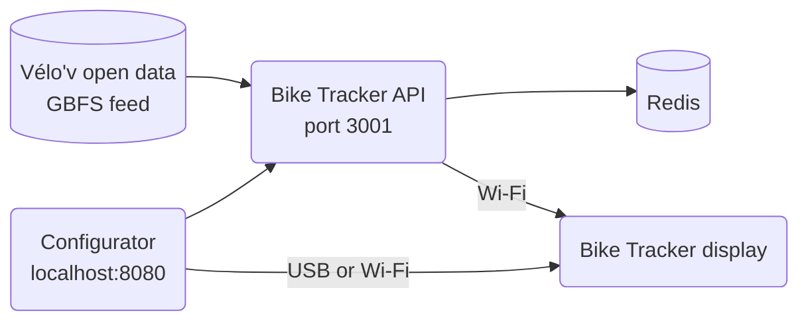

# Running Bike Tracker for Lyon Vélo'v on your own computer

This guide turns a Transit Tracker display (Adafruit Matrix Portal S3 with two 64x32 LED panels) into a **Bike Tracker** for Lyon's Vélo'v stations, with everything it needs running in Docker on your own computer.

Each row of the display shows one station:

```
Rouville  [P] 5   [bike] 0   [⚡bike] 11
           │       │          └── electric bikes available (green bike, yellow bolt)
           │       └── mechanical bikes available (red bike)
           └── free docks to return a bike (grey "P")
```

A count is grey when it is 0, and the whole row is grey when the station is closed. The display has room for 3 stations (2 if you add header text). Long names scroll; you can also give each station a short name like "Home".



- **Bike Tracker API** (this repository) reads the [Vélo'v GBFS feed](https://download.data.grandlyon.com/files/rdata/jcd_jcdecaux.jcdvelov/gbfs.json) every 30 seconds and streams station availability to the display. The feed is open data: no account needed.
- **Configurator** ([tiralmos/bike-tracker-configurator](https://github.com/tiralmos/bike-tracker-configurator)) is the web page you use to flash the display, connect it to Wi-Fi and pick your stations.
- **Redis** is used internally by the API.

The Docker files for this setup are in [`deploy/velov/`](../../deploy/velov/).

## 1. Prerequisites

- **Docker** with Compose v2 (`docker compose`, not `docker-compose`):
  - Windows or macOS: install [Docker Desktop](https://www.docker.com/products/docker-desktop/) and start it.
  - Linux: install [Docker Engine](https://docs.docker.com/engine/install/) and the Compose plugin.
- **Git**.
- **Google Chrome** or **Microsoft Edge**: the configurator talks to the display over USB with Web Serial, which other browsers do not support.
- The computer must stay on and be on the **same network** as the display. The display only supports **2.4 GHz** Wi-Fi.
- A **firmware release** must exist in [tiralmos/bike-tracker](https://github.com/tiralmos/bike-tracker/releases) (see [Publishing the firmware](#publishing-the-firmware) at the end). The configurator downloads it when it is built.

Check that Docker works:

```shell
docker compose version
```

> [!NOTE]
> Commands are written for a macOS/Linux terminal. On Windows, use **PowerShell**; where a command differs, the PowerShell version is given right after it.

## 2. Find your computer's address on your network

The display connects to the API using your computer's local IP address, usually something like `192.168.1.10`.

- Windows (PowerShell): `ipconfig`, then look for **IPv4 Address** under your Wi-Fi or Ethernet adapter.
- macOS: `ipconfig getifaddr en0` (or `en1` if that prints nothing).
- Linux: `hostname -I` (the first address).

Write it down. **Tip:** in your router's settings, reserve this address for your computer ("DHCP reservation"), so it doesn't change and break the display later.

## 3. Download both repositories

Put both repositories **in the same folder**, side by side:

```shell
mkdir bike-tracker
cd bike-tracker
git clone https://github.com/tiralmos/bike-tracker-api.git
git clone https://github.com/tiralmos/bike-tracker-configurator.git
```

You should now have:

```
bike-tracker/
├── bike-tracker-api/
└── bike-tracker-configurator/
```

## 4. Enter your computer's address

```shell
cd bike-tracker-api/deploy/velov
cp .env.example .env
```

PowerShell:

```powershell
cd bike-tracker-api\deploy\velov
Copy-Item .env.example .env
```

Open `.env` in a text editor and replace `192.168.1.10` with the address from step 2:

```
HOST_IP=192.168.1.42
```

The API uses port **3001** on your computer. If another program already uses that port, change `API_PORT` in the same file (for example `API_PORT=3002`), and use that number instead of 3001 everywhere in this guide.

## 5. Start everything

From `deploy/velov`:

```shell
docker compose up -d --build
```

The first build takes a few minutes. Check that the API sees the Vélo'v stations by opening this page in your browser:

<http://localhost:3001/stations/velov:1024>

You should see the live numbers for station 1024 (Rouville). Then check that the display will be able to reach it, using your own address:

`http://192.168.1.42:3001/stations/velov:1024`

If the first link works but not the second, your computer's firewall is blocking port 3001. On Windows, allow Docker Desktop on **private networks** when asked, or add an inbound rule for TCP port 3001.

Everything restarts on its own when the computer restarts (as long as Docker Desktop starts with it).

## 6. Flash the display and connect it to Wi-Fi

1. Open the configurator at **<http://localhost:8080>** in Chrome or Edge. Use `localhost`, not the IP address: the browser only allows USB access from `localhost`.
2. Plug the display's Matrix Portal board into the computer with a USB-C cable.
3. Click **Initial setup**.
4. Hold the **Boot** button on the board, press **Reset** while still holding Boot, then let go of both. The displays go dark: the board is in flashing mode.
5. Click **Flash firmware** and pick **USB JTAG/serial debug unit**.
6. When it's done, click **Continue to Wi-Fi setup**, choose your network and enter its password.

This replaces the Transit Tracker firmware. To go back, flash it again from the Transit Tracker configurator.

## 7. Choose your stations

1. Click **Continue to configuration** (or **Configure** on the configurator's home page).
2. Open the **Advanced** tab and check that the API server is `http://<your address>:3001`. It should already be filled in from step 4. If it says `localhost`, click **Change API server** and fix it: the display cannot use `localhost`.
3. In the **Stations** tab, click **Edit stations**.
4. Type part of a station name in the search box (for example `bellecour`) and click a result to add it. You can also click the dots on the map to see a station's current numbers before adding it.
5. Optionally type a short **name on the display** for each station, and use the arrows to put them in order. The first 3 are shown.
6. Click **Save**, then **Save configuration to device**.

The display shows "Loading..." for a few seconds, then your stations. Numbers update every 30 seconds or so.

You can change stations later the same way, over USB or over Wi-Fi (click **Change** next to "Not connected" at the top of the configuration page and pick the network option).

## Updating

```shell
cd bike-tracker-api
git pull
cd ../bike-tracker-configurator
git pull
cd ../bike-tracker-api/deploy/velov
docker compose build --no-cache configurator
docker compose up -d --build
```

The display updates its own firmware automatically when a new release is published (you can turn this off with the "Auto-Update" switch in its web page at `http://<display address>`).

## Troubleshooting

- **"No base URL set" or "Error loading stations"**: the display can't reach the API. Check the address in the Advanced tab, that `http://<your address>:3001/feeds` opens from another device on your Wi-Fi (e.g. your phone), and the firewall note in step 5.
- **"Stations not found"**: the selected stations no longer exist in the Vélo'v feed (stations are sometimes renumbered). Pick them again.
- **Flashing fails with "file not found"** or similar: the configurator was built before a firmware release existed. Run `docker compose build --no-cache configurator` then `docker compose up -d`.
- **Logs**: `docker compose logs -f api`.

## Publishing the firmware

This only needs doing once, and again whenever the display's code changes. In the [tiralmos/bike-tracker](https://github.com/tiralmos/bike-tracker) repository on GitHub:

1. Open the **Actions** tab and enable workflows if GitHub asks (they are off by default on forks).
2. Go to **Releases** → **Draft a new release**, create a tag such as `v1.0.0`, and click **Publish release**.
3. The "Release Stock Firmware" workflow builds the firmware (about 10 minutes) and attaches `firmware.factory.bin`, `firmware.ota.bin` and `manifest.json` to the release.

The firmware uses the display code from the `main` branch of [tiralmos/esphome-bike-tracker](https://github.com/tiralmos/esphome-bike-tracker), so make changes there first.
